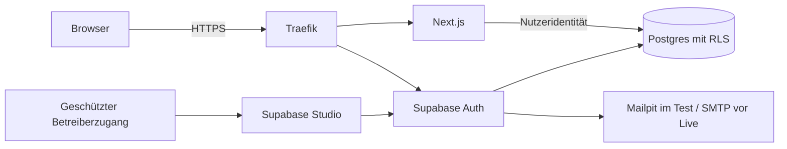
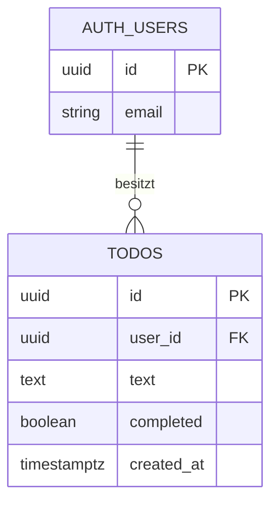

# Architektur: Todo-Web-App

Auftraggeber: Team · Stand: 2026-11-11 · Klasse: S · Heikel: nein (keine öffentliche Registrierung oder besonderen Daten)
Status: Entwurf

## 1. Kurzfassung
Internes Werkzeug (Typ A): mobil nutzbare Next.js/TypeScript-Web-App für persönliche Todos, mit selbst betriebenem Supabase Auth und Postgres auf einem ARM-Server. Ein App-Deployment als modularer Monolith; Auth und DB sind fertige Komponenten. Test und Live getrennt. Keine öffentliche Registrierung.

## 2. Anforderungen (aus dem Interview)

| # | Antwort |
|---|---|
| 1–2 | Ein Team, eine Rolle; eigene Todos anlegen, abhaken, wieder öffnen, löschen und abmelden. Keine öffentliche Registrierung. |
| 3 | 8 Nutzer heute, 15 in 12 Monaten, unter 100 gleichzeitig, DACH, meist Lesen; Ziel 20 Anfragen/s, p95 unter 500 ms. |
| 4–6 | E-Mail, Text, Erstellungszeit, Status; 2.000 Todos/Jahr; keine Gesundheits-, Finanz- oder Kinderdaten; Löschung bei Todo-/Kontolöschung. Keine Firmenbereiche. Mobil nutzbares Web, online. |
| 7–10 | Supabase selbst betrieben, Magic Link, Mailpit im Test, SMTP erst vor Live. Eigener ARM-Server, Compose, Test und Live getrennt; Live nach Freigabe. Ziel 99,5 %. Betreiber prüft werktags in Asia/Tokyo. Studio verwaltet Konten. Nur eigene Todos. |
| 11–15 | Test-Backup nur lokal; Serververlustrisiko akzeptiert, externe Kopie vor Live nötig. Älteste zuerst; mindestens vier Zeichen nach Rand-Leerzeichen, Löschung mit Dialog. Keine zusätzlichen laufenden Kosten, kein Termin. Umfang bestätigt. |

### Annahmen (noch zu klären)
- Tatsächlicher Serverstandort, verfügbare Serverressourcen und Erreichbarkeit sind noch nicht belegt.
- Ein Backup im lokalen Volume schützt nicht gegen den Verlust des Servers.
- Externer Speicher und dessen Kosten sind vor dem Livegang zu klären; ohne externe Kopie kein Livegang nach Betriebsstandard.

## 3. Systemübersicht

| Baustein | Aufgabe | Grund | Preis |
|---|---|---|---|
| Next.js, TypeScript | Oberfläche und serverseitige Todo-Aktionen, zustandslos | 1, 6, 12; ein Modul | Node-Betrieb und Updates |
| Supabase Auth, Studio | Magic-Link-Anmeldung und Kontoverwaltung | 2, 7, 9 | Betrieb und Updates |
| Postgres | Persistenz und Zeilenrechte | 1, 4, 9 | Backup und Migrationen |
| Traefik | HTTPS und Weiterleitung | 6, 8; Gateway Routing | zusätzlicher Ausfallpunkt |
| Mailpit / vorhandenes SMTP | Testmails abfangen / Login-Mails live | 7, 10 | SMTP erst vor Live verfügbar |
| Zwei Compose-Stacks, Volumes | Test und Live isolieren | 8, 15 | mehr RAM und Wartung |

Federated Identity: Identität von Supabase Auth; Health Endpoint: `/health` prüft App und DB. Kein n8n, Cache, Echtzeitdienst oder eigener Login nötig.

## 4. Daten

| Tabelle | Inhalt / personenbezogen | Wer liest | Wer schreibt | Konsistenz |
|---|---|---|---|---|
| `auth.users` (Supabase) | ID, E-Mail, Anmeldedaten; personenbezogen | Auth und geschütztes Studio | Auth/Studio, kein Browser-Direktzugriff | unmittelbar |
| `public.todos` | ID, Nutzer-ID, Text, Status, UTC-Erstellungszeit; personenbezogen | angemeldeter Eigentümer | derselbe Eigentümer | unmittelbar aus primärer DB; letzte Änderung gewinnt |

Eine Fachtabelle, eine Fachrolle. UUID als Schlüssel; `user_id` verweist auf `auth.users(id)` mit `ON DELETE CASCADE`. `completed` ist nicht null, Standard `false`; `created_at` ist nicht null, Standard DB-Zeit. Index `(user_id, created_at, id)`. Eigentümer und Erstellungszeit server-/DB-seitig festlegen, unveränderbar; Client darf nur `text` anlegen bzw. `completed` ändern. `text` nach Rand-Leerzeichen mindestens vier Unicode-Zeichen; Server und DB erzwingen maximal 1.000. Delete entfernt sofort; Backup-Löschung nach 30 Tagen. Export auf Anfrage über Studio; Konto-Löschung löscht Todos. Backups können bis Fristablauf gelöschte Daten enthalten.

Oberfläche `/` (angemeldet), `/login`, `/auth/callback`; `/health` ohne Login liefert Zustand und Revision. Auth-Endpunkte öffentlich, Studio geschützt, DB nie öffentlich. Server Actions: Liste (`401` ohne Sitzung), anlegen (`400`, `401`, `429`), Status setzen (`400`, `401`, `404` bei fremder/fehlender ID), löschen (`401`, `404`). Auth-Fehler ohne Existenzhinweis; technische Fehler ohne Details. Direkte REST-Zugriffe mit Nutzer-Token erzwingen dieselben Constraints, Spaltenrechte und RLS. Aufsteigend `(created_at,id)`, maximal 100 je Seite; alle Seiten erreichbar. Kein Partner-API-Vertrag.

## 5. Abläufe
1. Betreiber legt Konto in Studio an; Browser fordert Link für bestehendes Konto an. Kein Konto wird dabei erzeugt. Mailpit fängt Testmail ab; Link einmalig und höchstens 30 Minuten gültig. Ungültiger Link: generische Fehlermeldung; erneut anfordern.
2. Nutzer legt Todo an oder ändert Status: Server prüft verifizierte Sitzung und Schema, DB prüft Besitz und Constraint; Erfolg aktualisiert die Liste, Fehler zeigt Nachricht ohne Datenverlust im Formular. Fremde IDs ändern nichts.
3. Nutzer bestätigt Löschung, Server und DB prüfen Besitz, Zeile wird entfernt; Abmelden beendet die aktuelle Sitzung. Bei konkurrierenden Statusänderungen gilt die letzte gespeicherte Änderung.

## 6. Skalierung: was bricht zuerst?
Annahme: 15 Nutzer × 20 Aktionen/Tag = 300/Tag, im Mittel ca. 0,0035/s; 20/s ist ein separates Spitzenziel. 2.000 Todos/Jahr, geschätzt 1 KiB inkl. Overhead = ca. 2 MiB/Jahr ohne Indizes/Backups; nicht gemessen. Bei 10-fachem Wachstum DB-/Serverlast und Listenlänge prüfen. N+1 und unnötige Spalten vermeiden; je Seite eine Abfrage und Index.

| Stufe | Symptom | Messen | Auslöser | Lösung | Preis | V1 |
|---|---|---|---|---|---|---|
| 0 | Serverausfall | externer Health-Check | 1 fehlgeschlagener Check | ein ARM-Server, eine DB je Umgebung | Ausfallpunkt | ja |
| 1 | Liste langsam | Abfrageplan und p95 | p95 > 500 ms bei 20/s | Index Eigentümer/Zeit/ID; Seiten | zusätzlicher Schreibaufwand | ja |
| 2 | CPU/RAM ausgelastet | docker stats | > 70 % über 15 min | Server vergrößern | Kosten | nein |
| 3 | Verbindungen voll | DB-Verbindungszahl | > 80 % des eingestellten Limits für 5 min | vorhandenes Pooling prüfen, begrenzen | Betriebsaufwand | nein |
| 4 | Login wartet auf Mail | Auth-Latenz, SMTP-Fehler | > 2 s bei 95 % über 15 min | Mail entkoppeln und wiederholbar zustellen | zusätzlicher Zustellstatus | nein |
| 10 | ein Server reicht nicht | Lasttest/Verfügbarkeit | Ziel 20/s oder 99,5 % verfehlt | weitere zustandslose App-Instanz; DB bleibt Ausfallpunkt | Betrieb/Kosten | nein |

## 7. Sicherheit
Kernpunkte (S):
- Fertiges Supabase Auth statt eigener Passwortspeicherung; `shouldCreateUser=false` und serverseitig deaktivierte Registrierung, auch bei direktem Aufruf geprüft. Admin erstellt bestätigtes Konto; keine öffentliche Registrierung.
- Sitzung serverseitig mit `getClaims()` oder `getUser()` prüfen, nicht nur ungeprüftem `getSession()`; Tokens nicht in Logs. Cookies sicher über HTTPS; Magic-Link-Ablauf und Einmalnutzung testen.
- Zugriff serverseitig je Aktion; explizit öffentlich nur Login, Callback und eingeschränktes `/health`. Studio gesondert geschützt, nicht öffentlich offen.
- RLS in derselben Migration wie Tabelle einschalten: getrennte SELECT-, INSERT-, UPDATE-, DELETE-Regeln an `auth.uid() = user_id`; UPDATE prüft alte und neue Zeile. Service-Rolle umgeht RLS und darf nie im App-/Browsercode vorkommen.
- Fremde IDs: DB-Regel und serverseitige Besitzerprüfung; Tests mit A und B direkt und über App, auch bei Änderung und Löschen.
- Zod validiert sämtliche serverseitigen Eingaben; DB erzwingt Textlänge und Besitz zusätzlich. Parameterisierte Abfragen, Nutzereingaben escaped ausgeben, kein HTML aus Todo-Text.
- Geheimnisse ausschließlich auf Server in geschützter `.env`, nicht in Git, Build-Argumenten, Images, Browser oder Logs. Nur öffentlicher Schlüssel im Client; Abhängigkeiten und Images versioniert und regelmäßig prüfen.
- Außen nur HTTPS/HTTP für Weiterleitung und SSH; Datenbank und interne Container nicht öffentlich. SSH nur Schlüssel, Root-Login und Passwort-Login aus. HTTPS mit HSTS; Versionsheader entfernen.
- EU-Hosting und erforderliche Auftragsverarbeitungsverträge vor Livegang belegen; Serverstandort noch ungeprüft. Restliche ASVS-Punkte nach Schutzbedarf; keine Zahlungen, Uploads oder KI vorhanden.
- Testauswahl vor Live: Zugriff A/B, anonym, Eingabe/XSS, vergessene Pfade, HTTPS-Header, Ports, Geheimnisse; Ergebnisse datiert dokumentieren. Noch nicht ausgeführt.

## 8. Betrieb
Getrennte ARM-Compose-Projekte mit eigenen Domains, DBs, Schlüsseln und Volumes; keine Produktionsdaten in Staging. ARM64-Image einmal bauen, festen SHA und denselben Digest in Test und Live verwenden. Server zieht `staging`/`prod`; Rollback auf letzten guten SHA. Migrationen rückwärtskompatibel und zuerst in Staging. `/health` prüft DB und Revision. Alle Images anhand Originalquelle für ARM64 pinnen und testen. Workflow-Dateien installiert der Mensch, nicht der Bauagent.

Täglicher DB-Dump und Backup vor Migration, verschlüsselt im Volume, 30 Tage; Erfolg täglich kontrollieren. Test-Ausnahme ohne externe Kopie: Serververlust vernichtet Daten und Backup. Vor Live externe Kopie und Restore-Test in separater DB mit Zeitmessung, danach monatlich. Datenverlustziel 24 h zuzüglich fehlgeschlagener Sicherung; Wiederherstellungsziel 8 Arbeitsstunden, ungetestet. DB, Proxy und Server sind Ausfallpunkte; keine Bereitschaft außerhalb Werktagen Asia/Tokyo. 99,5 % ist Ziel, keine Garantie.

Logs 30 Tage ohne Tokens/E-Mail-/Todo-Inhalte; Anfragekennung. Externer Check und Alarm an Betreiber bei Ausfall, Backup-Fehler, Zertifikatsablauf und Platte > 80 %. Automatische Updates, Logrotation und SSH-Härtung im Setup. SMTP vor Live mit SPF/DKIM/DMARC und Zustelltest; Mailpit nicht öffentlich. Wenn externe Überwachung/Backup nicht kostenfrei verfügbar sind, Livegang bis Klärung blockiert. Bestehende Server-/Domainkosten unbekannt, Zusatzbudget 0.

CI-Ziel: `make check` lokal/PR, Image-Scan, Staging-E2E und später Promotion desselben Digest; öffentliche Repo-Schutzfunktionen und verfügbare GitHub-Kontingente vor Einrichtung verifizieren. Keine Überwachung oder CI wird hier als bereits eingerichtet behauptet.

## 9. Bauplan
Siehe [BAUPLAN.md](BAUPLAN.md); erster Schritt `geruest`.

## 10. Nicht in Version 1
Öffentliche Registrierung, eigene Kontenverwaltung, separate Handy-App, Offline-Nutzung, Integrationen außer Anmeldung, geteilte Todos, Echtzeit-Synchronisation. Externe Backup-Kopie und echtes SMTP sind vor Livegang nötig, aber nicht Voraussetzung für isolierten Testbetrieb.

## 11. Über der Klasse
Eine fachliche Tabelle und eine Fachrolle; keine weitere Klassenüberschreitung. Backup-Ausnahme nur im Testbetrieb, siehe Abschnitt 8.

## 12. Entscheidungen
001 Plattform und Datenbank; 002 Anmeldung und Konten; 003 Betrieb und Sicherung: siehe `entscheidungen/`.

## 13. Glossar
| Begriff | Bedeutung und Beispiel |
|---|---|
| Magic Link | Ein zeitlich begrenzter Anmeldelink per E-Mail, z. B. aus Mailpit im Test. |
| RLS | Datenbankregeln begrenzen Zeilen je Nutzer, z. B. nur eigene Todos. |
| Migration | Versionierte Änderung der Datenbankstruktur, z. B. Tabelle mit Rechteregeln anlegen. |
| Staging | Getrennte Testumgebung vor Live, z. B. mit eigener Datenbank. |
| Compose | Startet zusammengehörige Container, z. B. App und Datenbank. |
| Digest | Unveränderliche Inhaltskennung eines Images, z. B. gleicher Build in Test und Live. |
| p95 | 95 % der Messwerte liegen darunter, z. B. 500 ms Antwortzeit. |
| SMTP | Protokoll für Mailversand, z. B. der vor Livegang bereitzustellende Mailserver. |
